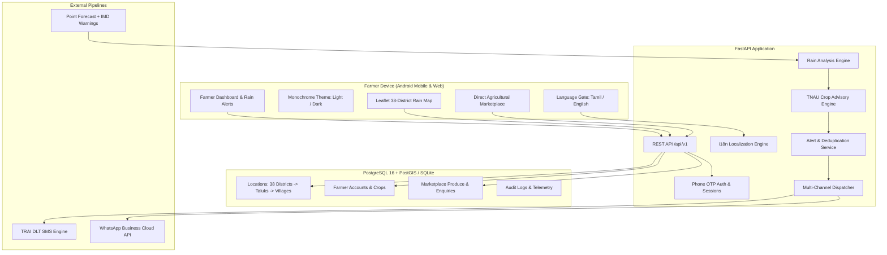

# TAMIL NADU FARMER RAIN ALERT & MARKETPLACE FOR ANDROID & WEB

[](https://github.com/PraveenM-6124/Tn-farmer-rain-alert/actions/workflows/ci.yml)
[](LICENSE)
[](https://www.python.org/)
[](https://fastapi.tiangolo.com/)
[](https://postgis.net/)

Tamil Nadu Farmer Rain Alert & Marketplace is a production-grade weather forecasting, advisory, and direct agricultural marketplace platform built with FastAPI, PostgreSQL + PostGIS, and a lightweight monochrome design system. It is designed specifically for Tamil Nadu farmers operating on low-end Android phones and slow 2G/3G connections to receive hyperlocal rain alerts early enough to protect their crops, followed by a direct marketplace to sell harvested produce directly to buyers without middlemen.

> *"Know the rain before it comes. Know what to do. And sell what you grow."*  
> *"மழை வரும் முன் அறிவோம். செய்ய வேண்டியதை அறிவோம். விளைவித்ததை விற்போம்."*

---

## Features
- **First-Visit Language Gate**: Mandatory bilingual selection (தமிழ் `ta` / English `en`) on first visit before site entry, persisted in cookies and database.
- **Dynamic Monochrome Theming**: High-contrast black & white identity (`#000000` / `#FFFFFF`) with persistent light and dark mode toggles (☀️/🌙), respecting `prefers-color-scheme` and WCAG 2.1 AA accessibility standards ($\ge 48\text{px}$ touch targets).
- **Hyperlocal Rain Analysis Engine**: 72-hour point forecast pipeline computing rain probability %, expected rainfall ranges in mm (e.g. `20–30 mm`), and IMD intensity classifications (Light, Moderate, Heavy, Very Heavy), cross-referenced with IMD district warnings.
- **Actionable Crop Advisory**: Farm-level actionable guidance (drainage clearance, harvest protection, staking, pesticide spray deferral) aligned with Tamil Nadu Agricultural University (TNAU) agronomic vocabulary.
- **Interactive Leaflet GIS Weather Map**: Visual GIS map covering all 38 districts of Tamil Nadu, color-coded by IMD severity warnings with interactive popups and aggregate impact metrics.
- **Multi-Channel Notification Pipeline**: Outbound alert dispatch across TRAI DLT-compliant SMS (UCS-2 Unicode accounting), WhatsApp Business Platform, and Web Push with strict idempotency and quiet hours compliance.
- **Direct Produce Marketplace**: Post-harvest marketplace allowing farmers to list grains, vegetables, and fruits, and receive buyer enquiries with phone number privacy protection.
- **Role-Protected Admin Console**: Comprehensive telemetry, audit logs, automated cron job monitoring, and listing moderation.
- **Data Privacy & Legal Compliance**: Built adhering strictly to India's Digital Personal Data Protection Act 2023 (DPDP Act) with phone hashing, encrypted credentials, masked listings, and full data erasure rights.

---

## Architecture & Tech Stack
- **Backend Framework**: Python 3.12+, FastAPI, Pydantic v2, SQLAlchemy 2.0, Alembic migrations.
- **Spatial Database**: PostgreSQL 16 + PostGIS 3.4 (GeoAlchemy2) with SQLite memory fallback for test suites.
- **Frontend Architecture**: Jinja2 templates, Leaflet.js GIS, CSS custom tokens, Zero-dependency Vanilla JS.
- **Localization (i18n)**: Key-parity translation system (`translations/en.json` & `translations/ta.json`) with automated CI parity tests.
- **Code Quality**: Pytest, Pytest-Asyncio, 44+ passing tests, Ruff linter/formatter, Mypy static typing.
- **DevOps & Containers**: Docker multi-stage non-root container, Docker Compose, GitHub Actions CI.



---

## Quick Start

### 1. Clone & Set Up
```bash
git clone https://github.com/PraveenM-6124/Tn-farmer-rain-alert.git
cd Tn-farmer-rain-alert

python -m venv .venv
# On Windows PowerShell:
.\.venv\Scripts\Activate.ps1
# On Linux/macOS:
source .venv/bin/activate

pip install -r requirements-dev.txt
cp .env.example .env
```

### 2. Seed Locations & Demo Data
Populate all 38 districts of Tamil Nadu, taluks, villages, synthetic demo farmers, and marketplace listings:
```bash
python scripts/seed_locations.py
python scripts/seed_demo_data.py
```

### 3. Run Application Server
Run using the custom local domain launcher:
```bash
python run.py
```
Or start Uvicorn directly:
```bash
uvicorn backend.app.main:app --reload --host 0.0.0.0 --port 8000
```
Open **[http://tnfarmerweathernoti.com:8000](http://tnfarmerweathernoti.com:8000)** (or `http://localhost:8000`) in your browser:
- On first visit, the **Language Gate** displays prompts in Tamil & English.
- Selecting your language unlocks the **Live Dashboard** with 72h weather forecasts and crop advisories.
- Navigate to **Rain Map** (`/map`) for the 38-district Leaflet GIS view.
- Navigate to **Marketplace** (`/marketplace`) to browse produce and send direct enquiries.
- Navigate to **Profile** (`/onboarding`) to test phone OTP verification and crop registration.
- Navigate to **Admin** (`/admin-ui`) for system telemetry and product moderation.

### 4. Run Test Suite & Linting
```bash
pytest
ruff check .
ruff format --check .
```

---

## Notes
- **Tamil Typography**: Incorporates Google's Noto Sans Tamil web font with local system font fallbacks for clear rendering across all Android versions.
- **Translation Integrity**: Every commit is verified by automated CI tests ensuring 100% key parity between `translations/en.json` and `translations/ta.json`.
- **Weather Honesty**: Weather forecasts are probabilistic; the UI and alerts communicate likelihood ("likely" / "வாய்ப்பு உள்ளது") rather than false absolute certainty.
- **Privacy First**: Farmer phone numbers are encrypted at rest and masked in public views in compliance with the DPDP Act 2023.

---

## Contribution Guidelines
Contributions are welcome. To contribute:
1. Fork the repository.
2. Create a feature branch (`git checkout -b feat/your-feature`).
3. Implement your changes and ensure all tests pass (`pytest`, `ruff check .`).
4. Commit using Conventional Commits (`feat: ...`, `fix: ...`, `test: ...`).
5. Submit a pull request with a clear description of modifications.

---

**Built by Praveen M : Building a resilient agricultural weather and marketplace platform.**
