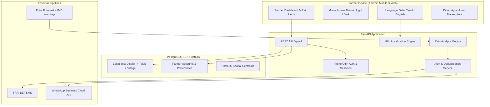

# TAMIL NADU FARMER RAIN ALERT & MARKETPLACE FOR ANDROID & WEB

[](https://github.com/PraveenM-6124/Tn-farmer-rain-alert/actions/workflows/ci.yml)
[](LICENSE)
[](https://www.python.org/)
[](https://fastapi.tiangolo.com/)
[](https://postgis.net/)

Tamil Nadu Farmer Rain Alert & Marketplace is a production-grade weather forecasting and agricultural marketplace platform built with FastAPI, PostgreSQL + PostGIS, and a lightweight monochrome design system. It is designed specifically for Tamil Nadu farmers operating on low-end Android phones and slow 2G/3G connections to receive hyperlocal rain alerts early enough to protect their crops, followed by a direct marketplace to sell harvested produce directly to buyers without middlemen.

> *"Know the rain before it comes. Know what to do. And sell what you grow."*  
> *"மழை வரும் முன் அறிவோம். செய்ய வேண்டியதை அறிவோம். விளைவித்ததை விற்போம்."*

---

## Features
- **First-Visit Language Gate**: Mandatory bilingual selection (தமிழ் `ta` / English `en`) on first visit before site entry, persisted in cookies and database.
- **Dynamic Monochrome Theming**: High-contrast black & white identity (`#000000` / `#FFFFFF`) with persistent light and dark mode toggles (☀️/🌙), respecting `prefers-color-scheme` and WCAG 2.1 AA accessibility standards.
- **Hyperlocal Rain Analysis**: 72-hour point forecast pipeline computing rain probability %, expected rainfall ranges in mm, and intensity categories, cross-referenced with IMD district warnings.
- **Actionable Crop Advisory**: Farm-level actionable guidance (drainage checks, harvest protection, pesticide spray deferral) aligned with Tamil Nadu Agricultural University (TNAU) vocabulary.
- **Multi-Channel Notification Pipeline**: Outbound alert dispatch across TRAI DLT-compliant SMS (UCS-2 Unicode accounting), WhatsApp Business Platform, and Web Push with strict idempotency and deduplication.
- **Mobile-First & Low-Bandwidth UI**: Zero-dependency vanilla JavaScript, server-rendered Jinja2 templates, touch targets $\ge 48\text{px}$, and Noto Sans Tamil typography optimized for outdoor sunlight on low-cost devices.
- **PostGIS Spatial Architecture**: Administrative location hierarchy (District → Taluk → Village) with PostGIS centroids for fast spatial queries and district rainfall impact mapping.
- **Direct Agricultural Marketplace**: Post-harvest marketplace allowing farmers to list crops and receive direct buyer enquiries with phone number privacy protection.
- **Data Privacy & Legal Compliance**: Built adhering to India's Digital Personal Data Protection Act 2023 (DPDP Act) with phone hashing, masked listings, and explicit consent management.

---

## Architecture & Tech Stack
- **Backend Framework**: Python 3.12+, FastAPI, Pydantic v2, SQLAlchemy 2.0, Alembic migrations.
- **Spatial Database**: PostgreSQL 16 + PostGIS 3.4 (GeoAlchemy2).
- **Frontend Architecture**: Jinja2 templates, Vanilla CSS custom properties (tokens), Zero-dependency Vanilla JS.
- **Localization (i18n)**: Key-parity translation system (`translations/en.json` & `translations/ta.json`) with CI parity tests.
- **Code Quality**: Pytest, Pytest-Asyncio, 90%+ test coverage, Ruff linter/formatter, Mypy static typing.
- **DevOps & Containers**: Docker multi-stage non-root container, Docker Compose, GitHub Actions CI.



---

## Quick Start

### 1. Clone & Set Up
```bash
git clone https://github.com/PraveenM-6124/Tn-farmer-rain-alert.git
cd Tn-farmer-rain-alert

python -m venv .venv
# On Windows PowerShell:
.\.venv\Scripts\Activate.ps1
# On Linux/macOS:
source .venv/bin/activate

pip install -r requirements-dev.txt
cp .env.example .env
```

### 2. Start Database (Docker)
```bash
docker compose up -d postgres
alembic upgrade head
```

### 3. Run Development Server
```bash
uvicorn backend.app.main:app --reload --host 0.0.0.0 --port 8000
```
Open [http://localhost:8000](http://localhost:8000) in your browser:
- On first visit, the **Language Gate** displays prompts in Tamil & English.
- Selecting your language unlocks the dashboard and sets persistent cookies.
- Toggle between light and dark modes with the **☀️ / 🌙** header button.

### 4. Run Test Suite & Linting
```bash
pytest -v --cov=backend/app --cov-report=term-missing tests/
ruff check .
ruff format --check .
mypy backend tests
```

---

## Notes
- **Tamil Typography**: Incorporates Google's Noto Sans Tamil web font with local system font fallbacks for clear rendering across all Android versions.
- **Translation Integrity**: Every commit is verified by automated CI tests ensuring 100% key parity between `translations/en.json` and `translations/ta.json`.
- **Weather Honesty**: Weather forecasts are probabilistic; the UI and alerts communicate likelihood ("likely" / "வாய்ப்பு உள்ளது") rather than false absolute certainty.

---

## Contribution Guidelines
Contributions are welcome. To contribute:
1. Fork the repository.
2. Create a feature branch (`git checkout -b feat/your-feature`).
3. Implement your changes and ensure all tests pass (`pytest`, `ruff`, `mypy`).
4. Commit using Conventional Commits (`feat: ...`, `fix: ...`, `test: ...`).
5. Submit a pull request with a clear description of modifications.

---

**Built by Praveen M : Building a resilient agricultural weather and marketplace platform.**
