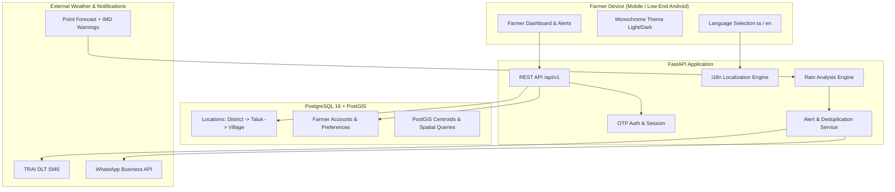

# 🌾 Tamil Nadu Farmer Rain Alert & Marketplace
> *"Know the rain before it comes. Know what to do. And sell what you grow."*  
> *"மழை வரும் முன் அறிவோம். செய்ய வேண்டியதை அறிவோம். விளைவித்ததை விற்போம்."*

[](https://github.com/your-username/tn-farmer-rain-alert/actions/workflows/ci.yml)
[](LICENSE)
[](https://www.python.org/)
[](https://fastapi.tiangolo.com/)
[](https://postgis.net/)

---

## 📖 Problem & Solution

### The Problem
Tamil Nadu farmers frequently face crop losses due to unpredicted rain events during harvesting, threshing, and pesticide spraying cycles. Most existing weather apps are heavy, cluttered, in English only, and lack location precision and actionable agricultural advice.

### The Solution
1. **Hyperlocal Rain Alerts**: High-confidence rain probability and mm volume ranges delivered early enough for farmers to act.
2. **Actionable Crop Advice**: What to do immediately (drainage checks, harvest protection, spraying deferral).
3. **Low-Bandwidth Monochrome UI**: High-contrast, mobile-first design system accessible on low-end Android phones and slow 2G/3G connections under harsh sunlight.
4. **Tamil First**: Native Tamil (`ta`) and English (`en`) support with first-screen language selection.
5. **Direct Marketplace**: Connecting verified farmers to buyers after harvest without middlemen.

---

## 🏛 Architecture Diagram



---

## 🛠 Tech Stack

- **Backend**: Python 3.12+, FastAPI, SQLAlchemy 2.0, Alembic, Pydantic v2
- **Database**: PostgreSQL 16 + PostGIS 3.4 (GeoAlchemy2)
- **Frontend**: Jinja2 templates, Vanilla CSS Custom Properties (Monochrome Design System), Vanilla JS (0 dependencies)
- **Localization**: Native JSON-based i18n (`translations/en.json`, `translations/ta.json`) with strict CI key parity
- **Code Quality**: pytest, pytest-asyncio, pytest-cov, ruff, black, mypy, pre-commit
- **Infrastructure**: Docker, docker-compose, GitHub Actions CI

---

## 📁 Repository Structure

```
tn-farmer-rain-alert/
├── backend/
│   └── app/
│       ├── main.py                  # FastAPI application entrypoint
│       ├── api/                     # REST API versioned endpoints
│       ├── models/                  # SQLAlchemy 2.0 ORM models (UUID PKs)
│       ├── schemas/                 # Pydantic v2 validation models
│       ├── services/                # Business logic (weather, alert, crop advice)
│       ├── core/                    # Config, security, database, i18n, logging
│       ├── tasks/                   # APScheduler & Celery background tasks
│       └── data/                    # Agronomic crop advisory rules (YAML)
├── frontend/                        # Templates (Jinja2) and static assets (CSS/JS)
├── translations/                    # Key-parity localization dictionaries (en.json, ta.json)
├── migrations/                      # Alembic database migrations
├── scripts/                         # Seeding scripts for locations and demo data
├── tests/                           # Unit, integration, and parity tests
├── docs/                            # Architecture, database, compliance & ADRs
├── docker-compose.yml               # Local PostGIS service setup
├── Dockerfile                       # Multi-stage non-root container image
└── .github/workflows/ci.yml         # Automated GitHub Actions CI workflow
```

---

## 🚀 Getting Started Locally

### 1. Prerequisites
- Python 3.12+ (or 3.13)
- Docker & Docker Compose (or local PostgreSQL with PostGIS extension)
- Git

### 2. Clone & Setup Virtual Environment
```bash
git clone https://github.com/your-username/tn-farmer-rain-alert.git
cd tn-farmer-rain-alert

python -m venv .venv
# On Windows PowerShell:
.\.venv\Scripts\Activate.ps1
# On macOS / Linux:
source .venv/bin/activate

pip install -r requirements-dev.txt
```

### 3. Configure Environment Variables
```bash
cp .env.example .env
```

### 4. Start PostGIS Database (Docker)
```bash
docker compose up -d postgres
```

### 5. Run Database Migrations
```bash
alembic upgrade head
```

### 6. Start Development Server
```bash
uvicorn backend.app.main:app --reload --host 0.0.0.0 --port 8000
```
Open [http://localhost:8000](http://localhost:8000) in your browser.

---

## 🧪 Running Tests & Quality Checks

Run test suite with coverage report:
```bash
pytest -v --cov=backend/app --cov-report=term-missing
```

Run code formatting and linting:
```bash
ruff check .
ruff format --check .
mypy backend tests
```

---

## ⚙️ Environment Variables Reference

| Variable | Default | Purpose |
| :--- | :--- | :--- |
| `ENV` | `development` | Environment mode (`development`, `test`, `production`) |
| `DEBUG` | `true` | Enables Swagger UI at `/docs` |
| `APP_PORT` | `8000` | HTTP service port |
| `DATABASE_URL` | `postgresql+psycopg://...` | Connection URI for PostgreSQL + PostGIS |
| `DEFAULT_LANGUAGE`| `ta` | Default language on first visit |
| `SUPPORTED_LANGUAGES`| `ta,en` | Active locales |
| `TIMEZONE` | `Asia/Kolkata` | IST display timezone |

---

## ⚠️ Known Limitations (Phase 1)
- **Phase 1 Boundary**: Farmer OTP registration, live weather provider integration, and rain analysis pipeline are stubbed for Phases 2–5.
- **SQLite Fallback**: Local automated unit tests use SQLite in-memory compilation fallback when PostGIS is unavailable.
- **Tamil Copy Review**: Translations are draft templates and will undergo native-speaker agricultural expert review (TNAU vocabulary).

---

## 🗺 Implementation Roadmap
- [x] **Phase 1**: Project Setup, FastAPI Core, PostGIS Models, First-Screen Language Selection, Theme & i18n
- [ ] **Phase 2**: Farmer Phone OTP Auth, Location Hierarchy (LGD), Profile & Consent
- [ ] **Phase 3**: Weather Provider Abstraction, Mock Provider, Open-Meteo & IMD Integrations
- [ ] **Phase 4**: Pure Function Rain Analysis Engine & Fixtures
- [ ] **Phase 5**: Multistage Alerts (24h/12h/3h/severe/change) with Idempotency
- [ ] **Phase 6**: Multichannel Notification Engine (SMS, WhatsApp, Push)
- [ ] **Phase 7**: Leaflet Rain Map & District Warnings
- [ ] **Phase 8**: TRAI DLT SMS & Meta WhatsApp Business APIs
- [ ] **Phase 9**: Crop Advisory Engine (TNAU Rules)
- [ ] **Phase 10**: Farmer Marketplace & Listings
- [ ] **Phase 11**: Admin Dashboard & Rain Impact Visualizer
- [ ] **Phase 12**: Security Hardening & Full Test Pass
- [ ] **Phase 13**: Production Docker Compose & Celery
- [ ] **Phase 14**: Cloud Deployment (Render/Railway/DigitalOcean)
- [ ] **Phase 15**: Documentation Polish, Screenshots & Live Demo

---

## 📜 License
This project is licensed under the [MIT License](LICENSE).
