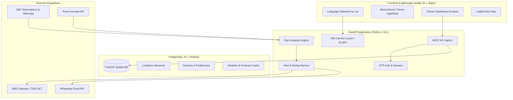

# System Architecture & Technical Design

## Overview
**Tamil Nadu Farmer Rain Alert & Marketplace** is built as a resilient, accessible, low-bandwidth web service providing timely rain alerts to Tamil Nadu farmers, followed by an agricultural marketplace.

## Phase 1 Implementation Scope
- FastAPI application core and `/health`, `/ready` endpoints.
- PostgreSQL + PostGIS schema initialization with Alembic.
- Core models: `Farmer` (with language & theme preferences) and `Location` (with PostGIS spatial centroid).
- Internationalization module (`i18n.py`) supporting Tamil (`ta`) and English (`en`) with fallback and key-parity testing.
- First-screen language selection flow and monochrome design system (WCAG 2.1 AA, `>=44px` tap targets, CSS custom properties).
