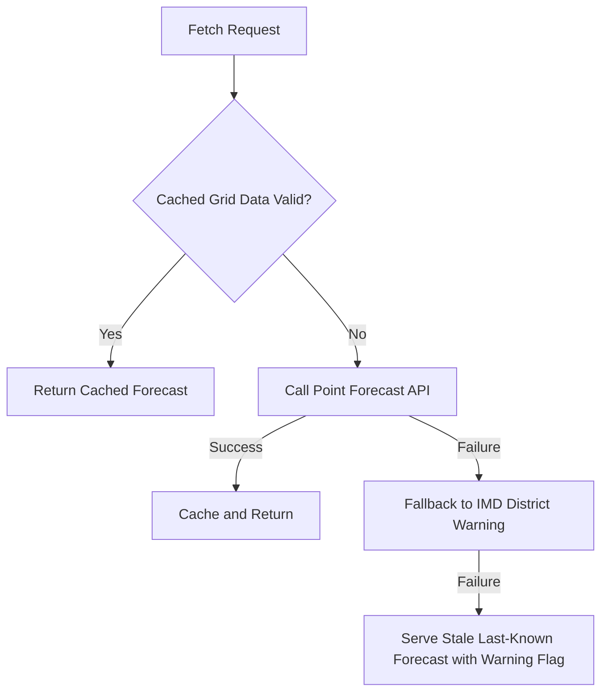

# Weather System & Ingestion Pipeline

## Architecture Overview
The weather subsystem aggregates two primary sources:
1. **Point Forecasts**: 72-hour hourly forecasts (rain probability, rainfall volume in mm, temperature, humidity, wind gusts).
2. **India Meteorological Department (IMD)**: District warnings, nowcasts, and AWS/ARG actual observed rainfall.

## Grid-Based Caching
To prevent duplicate upstream API requests for neighboring farmers, forecasts are cached at a coarse grid cell (~0.1° latitude/longitude, approximately 11 km). Farmers within the same grid cell share the same normalized forecast record.

## Fallback Chain

